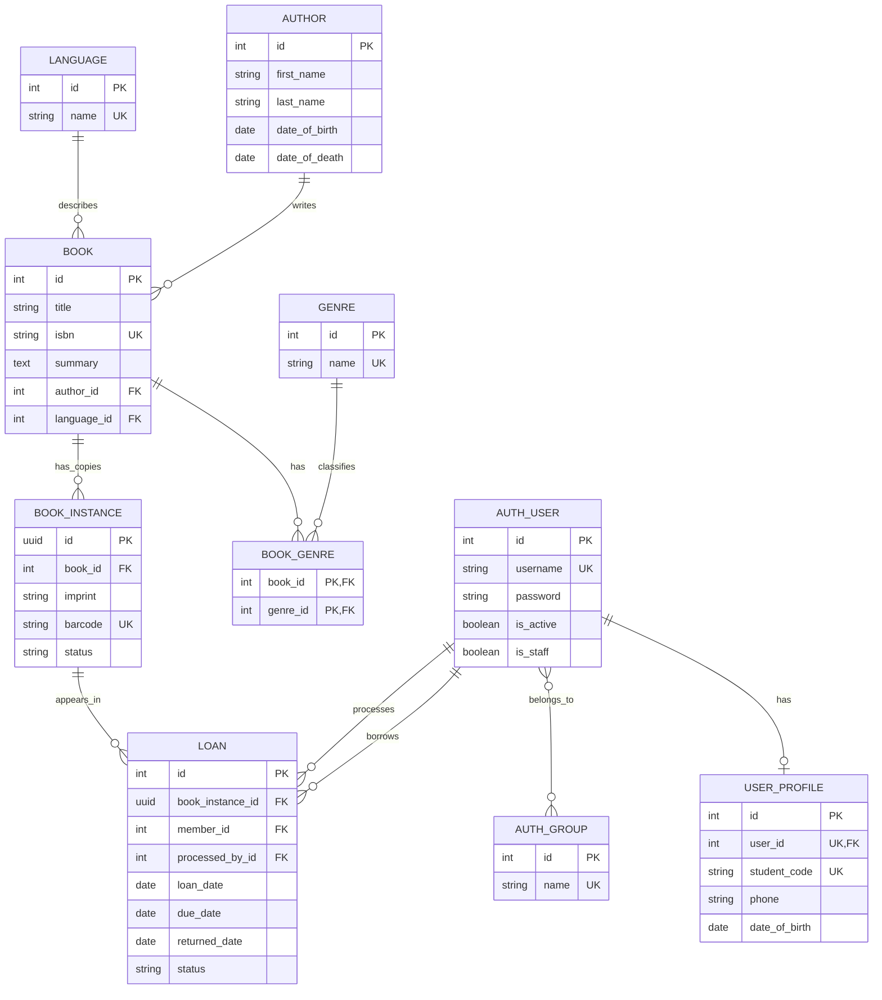

# ERD toàn hệ thống

Sơ đồ dưới đây chia theo ba domain ở mức code và module, nhưng vẫn dùng chung một database. Các quan hệ giữa domain chỉ dùng khóa ngoại cần thiết cho những UC đã xác định.

## Phạm vi từng domain

### Domain 1: `catalog`

`Author`, `Language`, `Genre`, `Book`, `BookGenre`, `BookInstance` bám theo các model của MDN. `BookInstance` đại diện cho một cuốn vật lý và chứa UUID/mã barcode cùng trạng thái `available`, `on_loan`, `maintenance` hoặc `retired`.

### Domain 2: `accounts`

`AUTH_USER`, `AUTH_GROUP`, permission và session do Django tạo. `UserProfile` là bảng mở rộng tùy chọn cho thông tin sinh viên. Không tạo hệ thống role/JWT/OAuth riêng trong baseline.

### Domain 3: `circulation`

`Loan` là phiếu mượn gắn một người dùng với một `BookInstance`. Gia hạn cập nhật `due_date`; trả sách cập nhật `returned_date`, `status` của loan và trạng thái bản sao. Không thêm bảng riêng cho các luồng chưa có trong UC.
